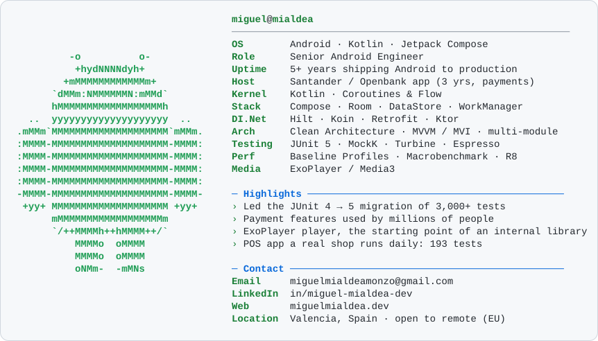

  <picture>
    <source media="(prefers-color-scheme: dark)" srcset="./dark_mode.svg">
    
  </picture>

  
  
  
  

### 📱 Featured projects

<table>
  <tr>
    <td width="50%" valign="top">
      <h4>🧾 <a href="https://github.com/MiguelAMialdeaDev/warrantyvault">WarrantyVault</a></h4>
      Warranties and receipts with expiry reminders, on its way to Google Play. Multi-module Clean Architecture and 190+ unit tests.  
      <code>Compose</code> <code>Room</code> <code>WorkManager</code> <code>Play Billing</code>
    </td>
    <td width="50%" valign="top">
      <h4>🏟️ <a href="https://github.com/MiguelAMialdeaDev/matchday">Matchday</a></h4>
      Live-event app that keeps working when the stadium network doesn't. Offline-first, WebSocket deltas, honest connection state.  
      <code>Kotlin</code> <code>Compose</code> <code>Ktor</code> <code>Room</code> <code>FastAPI</code>
    </td>
  </tr>
  <tr>
    <td width="50%" valign="top">
      <h4>💸 <a href="https://github.com/MiguelAMialdeaDev/ExpenseTracker">ExpenseTracker</a></h4>
      Multi-module expense tracker built around Clean Architecture boundaries.  
      <code>Koin</code> <code>Room</code> <code>Compose</code> <code>Clean Architecture</code>
    </td>
    <td width="50%" valign="top">
      <h4>🛸 <a href="https://github.com/MiguelAMialdeaDev/RickAndMortyApp-AI">Rick &amp; Morty, modular</a></h4>
      <code>:domain</code> / <code>:data</code> / <code>:app</code> modules with paging and shared element transitions.  
      <code>Paging 3</code> <code>Hilt</code> <code>Turbine</code> <code>Compose</code>
    </td>
  </tr>
</table>

### 🛠️ Tech I work with

  

**Exploring:** Kotlin Multiplatform (personal projects) · Android TV · agentic development workflows

<i>Based in Valencia 🇪🇸 · Spanish (native) · English (B2, daily use with international teams)</i>

